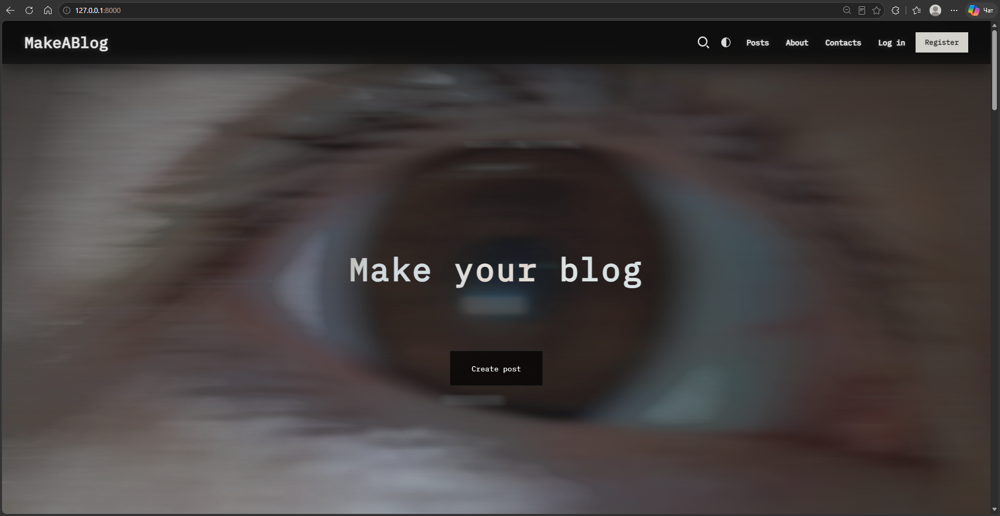
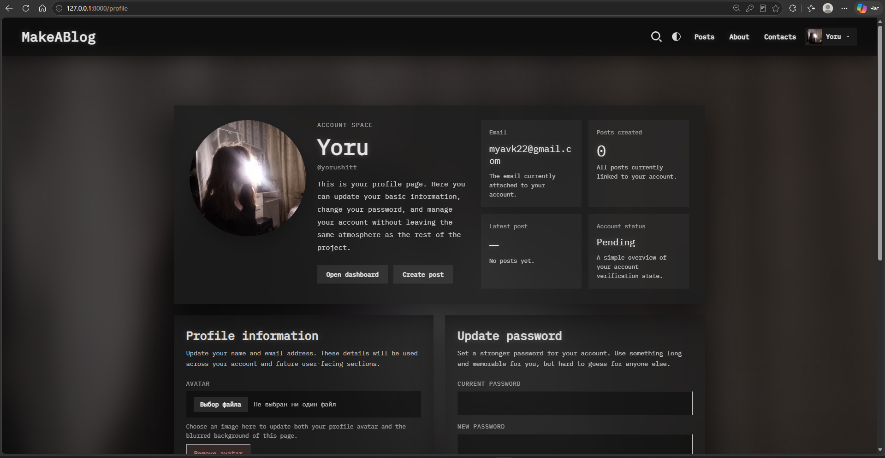
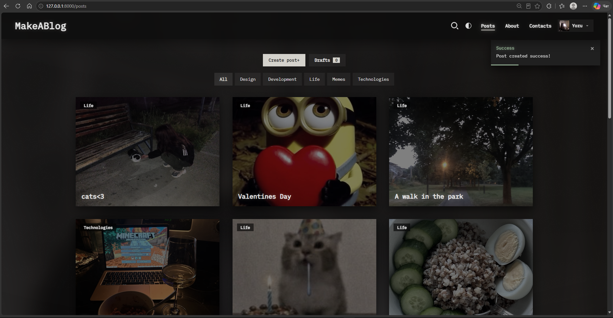
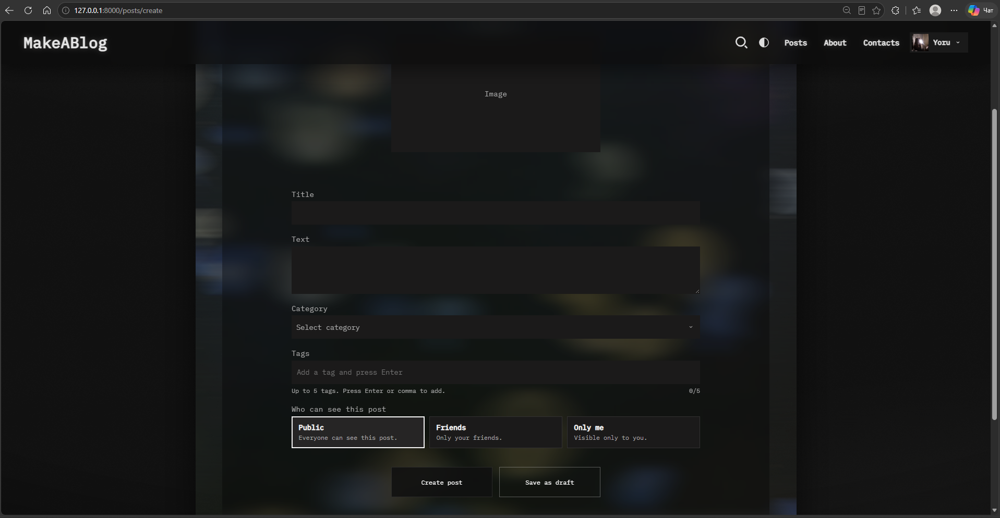
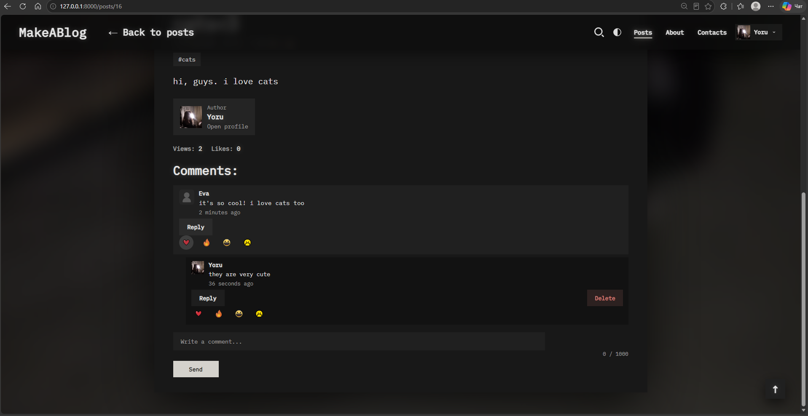
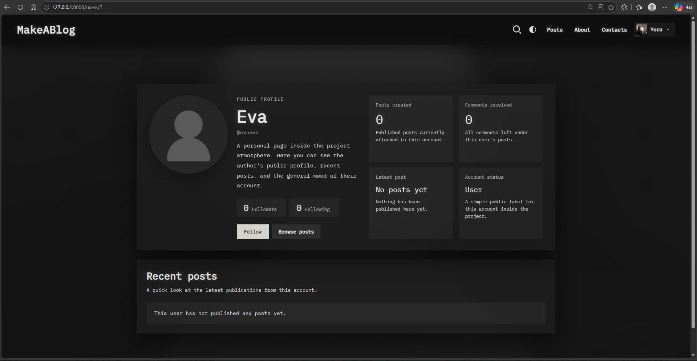
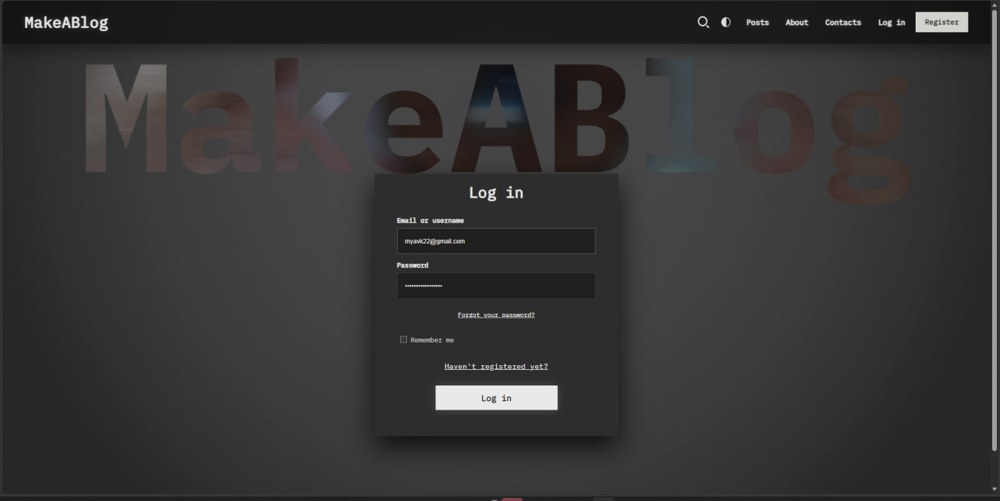
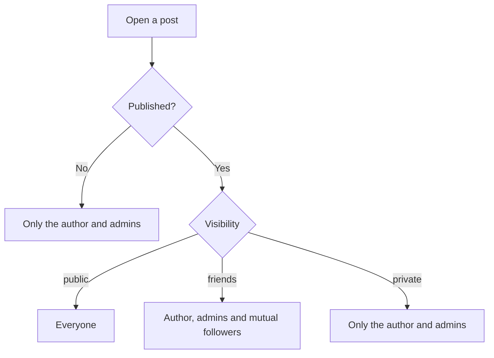
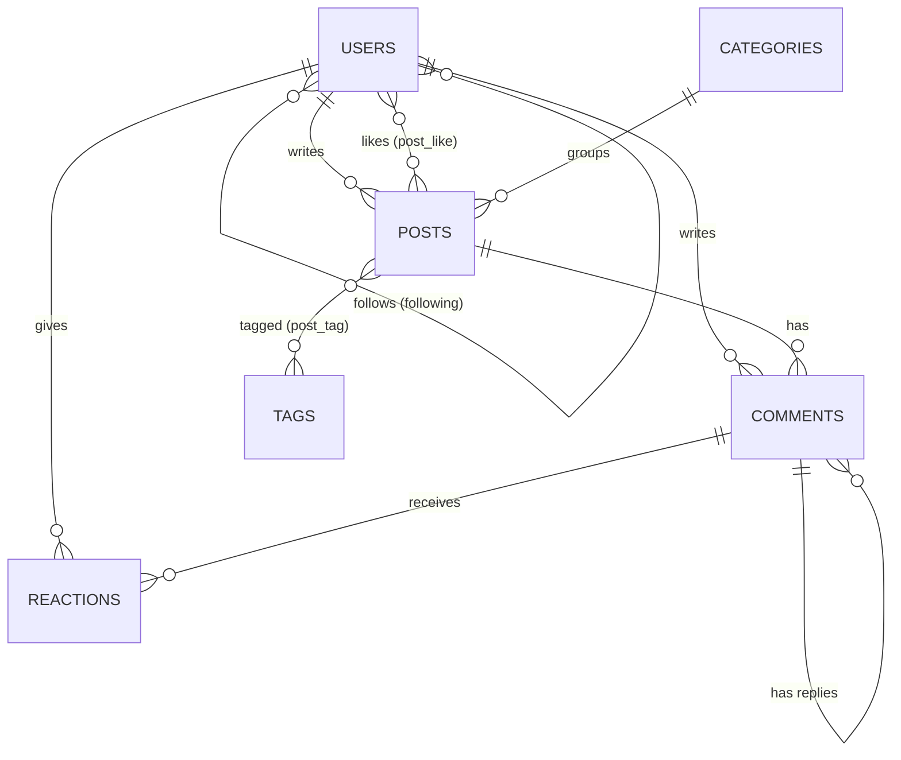

<p align="center">
  
</p>

<p align="center">
  
</p>

<p align="center">
  
  
  
  
  
  
  
</p>

---

##  About the project

**MakeABlog** is an interactive content ecosystem (a small social network) built with Laravel. It erases the line between a quiet personal blog and live communication: stories about life, notes from work and official announcements live in one feed, with friends, reactions and smooth micro-animations.

> [!TIP]
> Run `php artisan migrate --seed` and you get a ready-made demo: authors with avatars, posts with cover images, comments, replies, reactions and friends. The site is never empty on first launch.

---

## Gallery

<p align="center">
  
</p>

<table>
  <tr>
    <td width="50%"></td>
    <td width="50%"></td>
  </tr>
  <tr>
    <td width="50%"></td>
    <td width="50%"></td>
  </tr>
  <tr>
    <td width="50%"></td>
    <td width="50%"></td>
  </tr>
</table>

---

## Features

###  Content

| | |
|---|---|
| **Posts CRUD** | Create, edit and delete posts with a cover image (uploaded to ImgBB, with timeouts and error handling) |
| **Categories and tags** | Browse the feed by category or tag, up to 5 tags per post |
| **Drafts** | Save an unfinished post, come back later and publish it. Drafts are visible only to the author |
| **Visibility** | `public`, `friends` (mutual followers only) or `private` for every post |
| **Views counter** | One view per visitor per day, with no refresh abuse |
| **Read more** | Long descriptions collapse with a smooth *Show more / Show less* toggle |
| **Live search** | Instant search that respects drafts and privacy |

###  Social

| | |
|---|---|
| **Follow system** | Follow / Unfollow authors. Two people who follow each other become friends |
| **Public profiles** | Avatar, stats, recent posts with covers. Hidden posts never leak |
| **Post likes** | One like per user, the counter updates on the fly |
| **Comments** | Comments and threaded replies, instant add and delete without a page reload |
| **Reaction engine** | Emoji reactions on comments: like, dislike, heart, laugh. A second click removes it |

###  Security and accounts

- **Auth system:** session-based (Breeze), sign in with **email or username**, password reset and CSRF protection.
- **Authorization:** only the author or an admin can edit or delete a post or comment. Visibility rules are enforced on pages, search and the API.
- **Rate limiting:** login, registration, posts, comments, uploads, likes and follows.
- **Safe uploads:** MIME type, size (5 MB) and dimension validation for every image.
- **Data cleanup:** deleting a post, comment or account removes comments, replies, reactions, likes and follows.
- **Profile customizer:** change name, username, email and avatar, change password, delete the account.

### Admin panel

- Platform overview with counters and the latest posts, comments and users.
- Lists of all posts, comments and users with moderation.
- Promote or demote administrators (you cannot change your own role).

### REST API (v1)

Token authentication with Laravel Sanctum. Reading is public, writing requires a token.

| Method | Endpoint | Auth |
|---|---|---|
| `POST` | `/api/v1/login` | Email **or** username and password |
| `POST` | `/api/v1/logout` | Token |
| `GET` | `/api/v1/posts`, `/api/v1/posts/{id}` | Public (respects visibility) |
| `POST` `PUT` `DELETE` | `/api/v1/posts`, `/api/v1/posts/{id}` | Token (author or admin) |
| `GET` | `/api/v1/comments`, `/api/v1/comments/{id}` | Public (respects visibility) |
| `POST` `PUT` `DELETE` | `/api/v1/comments`, `/api/v1/comments/{id}` | Token (author or admin) |

```bash
curl -X POST http://127.0.0.1:8000/api/v1/login \
  -H "Accept: application/json" \
  -d "email=anna_k&password=password"
```

### UX details

- **Smooth, cinematic scrolling** with [Lenis](https://lenis.darkroom.engineering/).
- A compact main menu (*Posts, About, Contacts*) and a **horizontal user bar** that slides out right under it.
- Hover effects on post cards, animated reactions and a responsive layout down to phones.

---

## Who can see a post?



## Data model



---

## Tech stack

<p align="center">
  
</p>

Laravel 11, PHP 8.2+, MySQL, Sanctum, Blade, Tailwind CSS (auth pages), custom CSS, vanilla JS, Lenis, ImgBB for images.

---

## Quick local setup

```bash
# 1. Clone the project
git clone https://github.com/Yoru-mine/Blog-Posts.git
cd Blog-Posts

# 2. Install dependencies and prepare the environment
composer install
npm install
cp .env.example .env
php artisan key:generate
```

Open `.env` and set your database and image host:

```env
APP_ENV=local
APP_URL=http://127.0.0.1:8000

DB_CONNECTION=mysql
DB_DATABASE=makeablog
DB_USERNAME=root
DB_PASSWORD=

IMGBB_API_KEY=your_imgbb_key_here
```

```bash
# 3. Create the tables and fill them with demo content
php artisan migrate --seed

# 4. Start everything (two terminals)
npm run dev
php artisan serve
```

Open **http://127.0.0.1:8000** and sign in with a demo account.

> [!IMPORTANT]
> Use `APP_ENV=local` and an `http://` `APP_URL` on your machine. Only a real server with HTTPS should run `APP_ENV=production`.
> The demo seeder **does nothing in production** because its accounts use a known password.

### Demo accounts (local only)

All accounts use the password `password`.

| Username | Email | Role |
|---|---|---|
| `admin` | `admin@example.com` | Administrator |
| `anna_k` | `anna_k@example.com` | Author (has a draft and many friends) |
| `david_m` | `david_m@example.com` | Author (has a friends-only post) |
| `lina_s` | `lina_s@example.com` | Author |
| `omar_r` | `omar_r@example.com` | Author |
| `sofia_t` | `sofia_t@example.com` | Author |

Seed images live in `public/images/seed`. To reset the demo data, run `php artisan migrate:fresh --seed`.

---

## Testing

```bash
php artisan test
```

The suite covers authentication, profile updates, post visibility and privacy, comment and reaction access, data cleanup, follows, rate limits and the REST API (64 tests).

---

## Roadmap

- [x] Posts, comments, replies and reactions
- [x] Categories, tags and drafts
- [x] Friends-only and private posts
- [x] Follow system and public profiles
- [x] REST API with Sanctum
- [ ] Feed of followed authors
- [ ] Notifications (comments, replies, new followers)
- [ ] Full-text search
- [ ] Post promotion

---

<p align="center">
  Made with ❤️ and Laravel by <a href="https://github.com/Yoru-mine"><b>Yoru-mine</b></a>
</p>

<p align="center">
  
</p>
