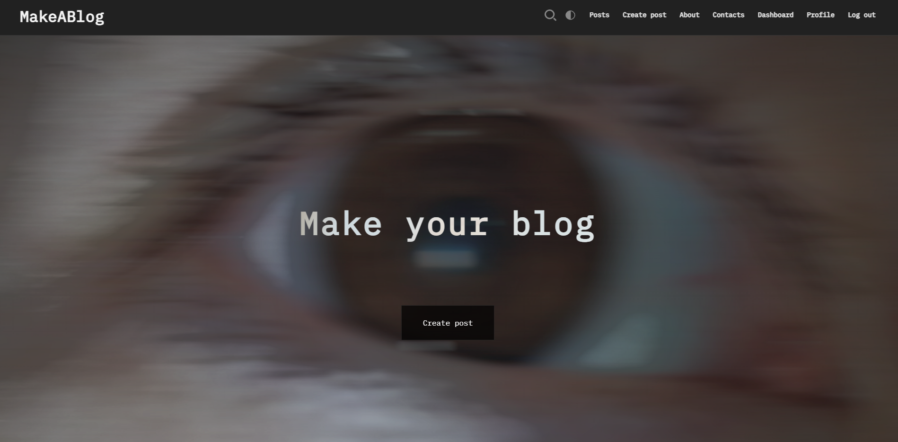
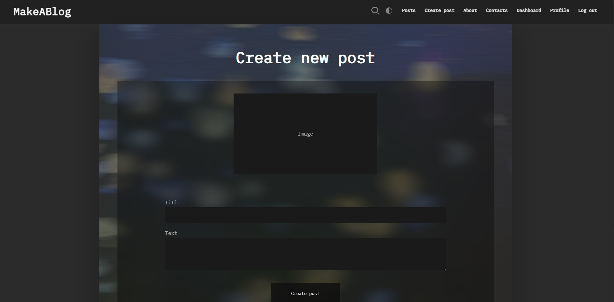
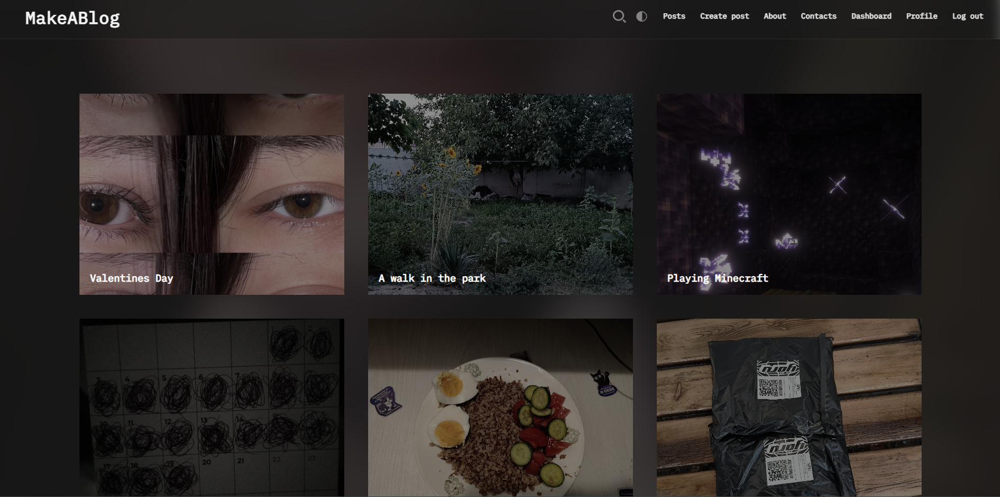
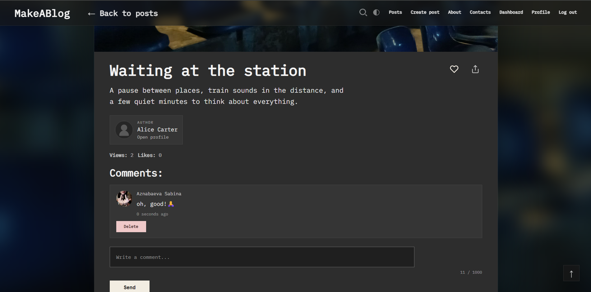
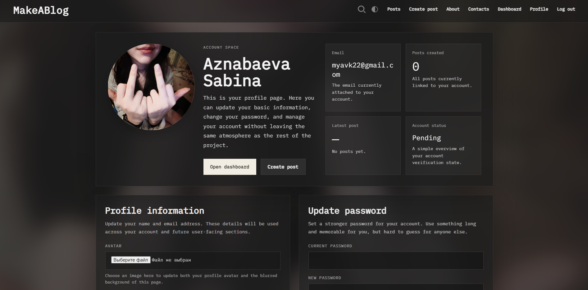
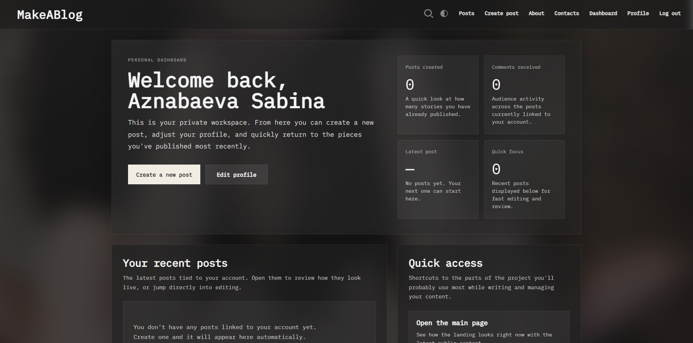
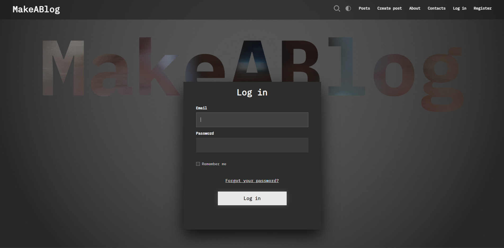

<p align="center">
  
</p>

<div align="center">
    
    
    
    
    
    
    
    
</div>

<p align="center">
  
  
  
  
</p>

---

##  About the System

**MakeABlog** is an interactive content ecosystem (social network) built with Laravel. The project completely erases the line between a boring blog and live communication, thanks to micro-animations, dynamic reactions, and an instantly responsive interface.

---

---

## 📸 Gallery & Effects (Media Preview)

<p align="center">
  <br><br>
  <br><br>
  <br><br>
  <br><br>
  <br><br>
  <br><br>
  
</p>

---
  <summary><b> 2. Interactions & Comments [ Click to view ]</b></summary>
  <br>
  <p align="center">
    
  </p>
  <p align="center">
    
  </p>
</details>

<details>
  <summary><b> 3. Admin Panel [ Click to view ]</b></summary>
  <br>
  <p align="center">
    
  </p>
  <p align="center">
    
  </p>
</details>

<details>
  <summary><b> 4. Additional Screens [ Click to view ]</b></summary>
  <br>
  <p align="center">
    
  </p>
</details>

---

## ⚡ Functional Architecture

###  Social Interaction
* 🔥 **`POSTS CRUD`** — Create, edit, and delete engaging posts.
* 💬 **`LIVE COMMENTS`** — Threaded discussions that keep users engaged.
* 🎭 **`REACTION ENGINE`** — An instant-feedback system:
  * ❤️ **Post likes** (counter updates on the fly).
  * 🌟 **Custom emoji reactions** on comments for pure emotional expression.

###  Security & User Account
* 🔐 **Auth System** — Session-based authentication, protected against CSRF and XSS attacks.
* 👤 **Profile Customizer** — Manage personal data, change passwords, and upload avatars.

###  Admin Panel (Control Center)
* 📊 Full monitoring of platform activity and counters.
* 🔨 One-click moderation: remove toxic comments and posts.

---

## 🚀 Quick Local Setup

```bash
# 1. Clone the project
git clone [https://github.com/myavkmrazi/MakeABlog.git](https://github.com/myavkmrazi/MakeABlog.git)

# 2. Set up the environment
composer install && npm install
cp .env.example .env
php artisan key:generate

# 3. Database and server start
php artisan migrate --seed
php artisan serve
